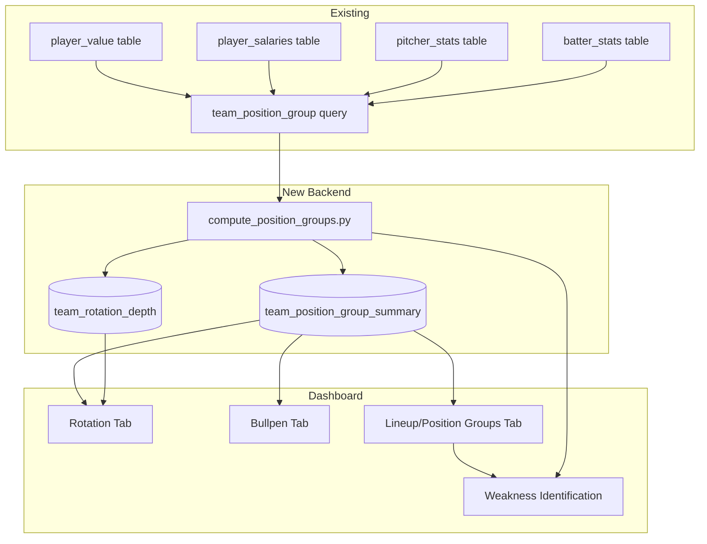
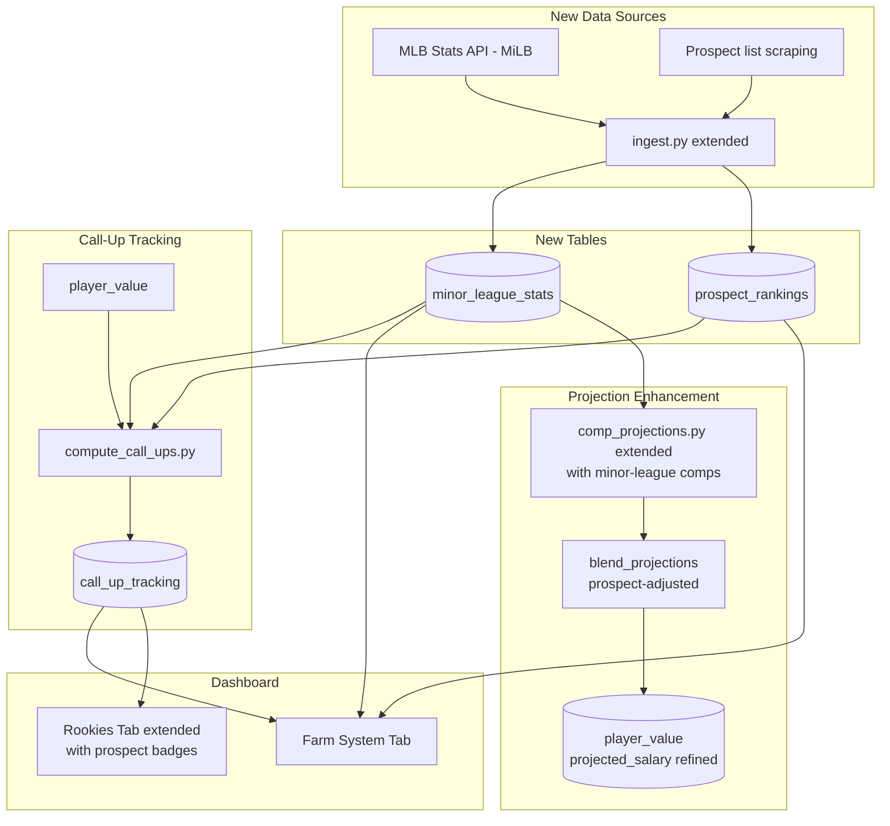
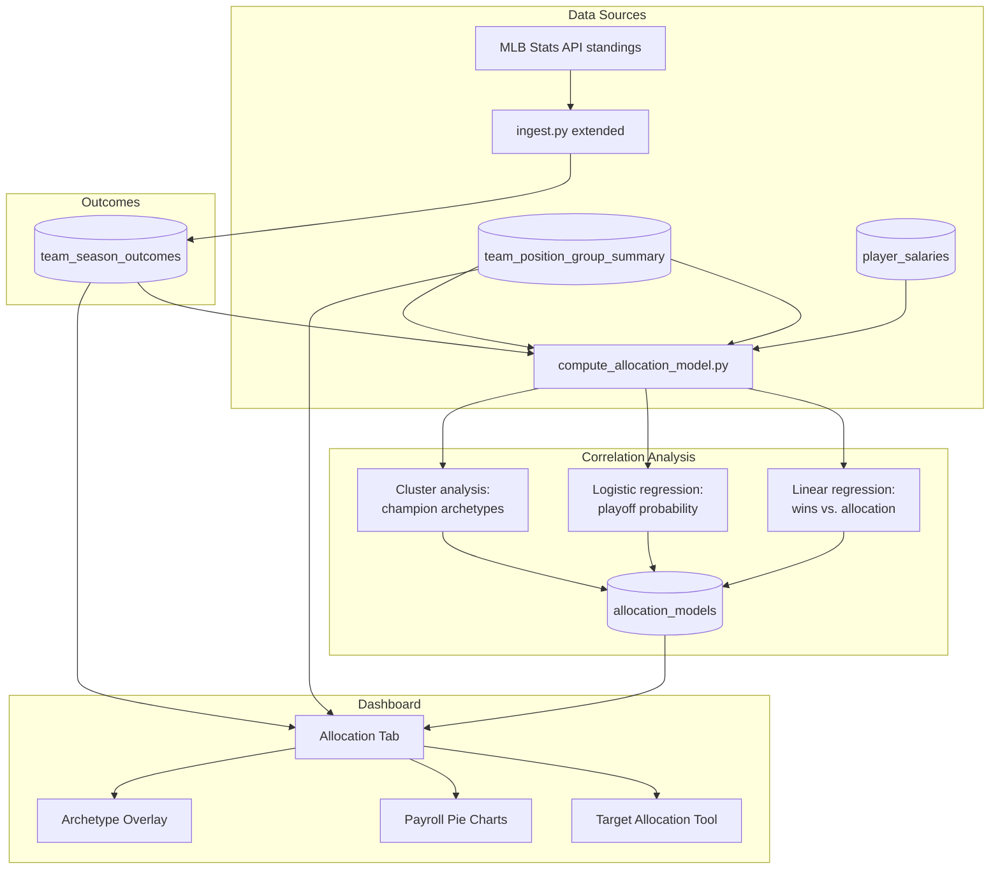

# MLB Market Value — Planning & Roadmap

A living document for feature planning, refactoring ideas, and program flow design. Use this workspace to sketch out new capabilities before building, track cross-cutting concerns, and document decisions for future reference.

---

## Project Status

### What's Built

A Python data pipeline ( [`backend/`](backend/) ) and a self-contained HTML dashboard ( [`frontend/dashboard/`](frontend/dashboard/) ) that correlate MLB player salaries with on-field performance.

**Data flow (current):**

```
Season ingest ──▶ compute_value ──▶ build_dashboard ──▶ splice_dashboard
(2-step pipleine)                  (compute percentiles)  (query DB → JSON)    (embed data → HTML)
```

1. [`run_ingest.py`](backend/app/pipeline/run_ingest.py) orchestrates pulls from MLB Stats API, Statcast, FanGraphs (batting/pitching/salary), and fielding sources. Upserts into Postgres. Historical seasons (2015-2025) have stats and fielding only — salary scraping is skipped (`--skip-salary`) because RosterResource only exposes current rosters.
2. [`run_compute_value.py`](backend/app/pipeline/run_compute_value.py) computes within-position z-scores, composite percentiles, salary percentiles, value scores, and pre-arb market salary projections. Writes [`player_value`](backend/app/models.py:171) and [`team_payroll_summary`](backend/app/models.py:189) tables.
3. [`build_dashboard.py`](frontend/dashboard/build_dashboard.py) queries the live DB fresh each run, computes Marcel and comp projections inline, and writes `dashboard_data.json`.
4. [`splice_dashboard.py`](frontend/dashboard/splice_dashboard.py) base64-encodes the JSON + fonts into a single `dashboard_final.html` file.

### Key Design Notes

- **Marcel projections** ([`projections.py`](backend/app/pipeline/projections.py)): Weighted 3-year regression using expected/process stats (xBA, xwOBA, chase rate, etc.), not raw outcomes. Regression constants are "reasonable estimates, not empirically calibrated to this dataset" (per docstring).
- **Comp projections** ([`comp_projections.py`](backend/app/pipeline/comp_projections.py)): Nearest-neighbor search against 2015-2024 historical player-seasons, using position-relative z-score fingerprints with recency weighting.
- **Blend**: Final projection is 50/50 Marcel + comp (controlled by [`COMP_BLEND_WEIGHT = 0.5`](backend/app/pipeline/projections.py:184)).
- **Pre-arb exclusion**: Players on pre-arbitration or MiLB contracts are excluded from salary comparison (CBA-minimum isn't market-determined) and get a projected market salary instead.
- **Dashboard**: A single-file HTML/JS/CSS app with live-adjustable stat weights, a diamond field view, and player detail modals.

---

## Regression Analysis Engine

> **Goal**: Build a retrospective accuracy measurement system that validates and iteratively tunes the projection models using 10 years of historical data.

### Motivation

The Marcel and comp projections are the theoretical core of the "what *should* this player be worth" signal, but they've never been systematically validated against what actually happened. The database already contains 2015-2025 full historical stats — a natural 10-year window to test every past projection against reality.

### Goals

- Gauge how well the current Marcel and comp projections track actual outcomes.
- Measure projection accuracy over time (does it improve/decay with more data?).
- Surface systematic biases (e.g., does the system overproject or underproject certain player types, ages, or positions?).
- Provide empirical grounding for tuning regression constants, weight schemes, and comp pool parameters.

### Current State

- [`projections.py`](backend/app/pipeline/projections.py) docstring explicitly states: *"Regression constants are reasonable estimates, not empirically calibrated to this dataset."*
- The Marcel weight scheme is hardcoded as `[5, 4, 3]` (most-recent-to-oldest).
- Age adjustment is a flat ±0.3%/year from peak age 29, no position-specific curve.
- Comp projections ([`comp_projections.py`](backend/app/pipeline/comp_projections.py)) use a fixed 10-year lookup window (2015-2024), `K_COMPS = 20`, `MAX_AGE_DIFF = 1.5`, and similarity weights that are "same spirit as the dashboard's composite scoring" — not empirically fit.
- **No accuracy tracking exists anywhere in the codebase.** Once a season is ingested, there's no feedback loop.

### Data Collection for Retrospective Analysis

The 2015-2025 historical data (stats without salary) provides a natural 10-year retrospective window. For any past season *S* (say 2022), we can:

1. Recompute Marcel projections as-if in season *S*-1 (using seasons *S*-4, *S*-3, *S*-2).
2. Recompute comp projections as-of season *S*-1 (using the same 2015+ lookup pool, restricted to *S*-2 and earlier).
3. Compare both to the actual stats recorded for season *S*.

#### Proposed `projection_accuracy` Table

Add a new SQLAlchemy model to persist accuracy measurements:

```sql
CREATE TABLE projection_accuracy (
    id              SERIAL PRIMARY KEY,
    player_id       INTEGER NOT NULL REFERENCES players(player_id),
    player_type     player_type_enum NOT NULL,       -- 'batter' | 'pitcher'
    position        position_enum NOT NULL,
    season          SMALLINT NOT NULL,               -- the season being projected FOR
    projection_year SMALLINT NOT NULL,               -- when the projection was made (≈ season - 1)

    -- Which version of the projection produced this
    projection_type VARCHAR(20) NOT NULL,             -- 'marcel', 'comp', 'blend'

    -- Metrics at projection time
    marcel_weight_scheme VARCHAR(20),
    comp_k              SMALLINT,
    age_at_projection   NUMERIC(4,1),

    -- Per-stat error breakdown (stored as JSONB or individual columns)
    errors_json  JSONB,                               -- { "xwoba": { "projected": .345, "actual": .321, "abs_error": .024, "signed_error": -.024 }, ... }

    -- Aggregate error metrics (computed from errors_json)
    mae          NUMERIC(6,4),                        -- mean absolute error across all projected stats
    rmse         NUMERIC(6,4),                        -- root mean squared error
    signed_bias  NUMERIC(6,4),                        -- mean (projected - actual); positive = overprojection
    n_stats      SMALLINT,                            -- how many stats were compared

    -- Context
    pa_or_ip     NUMERIC(6,1),                        -- playing time (PA for batters, IP for pitchers)
    contract_type VARCHAR(40),                        -- what kind of deal the player was on

    computed_at  TIMESTAMPTZ NOT NULL DEFAULT now(),

    UNIQUE (player_id, season, projection_type)
);
```

This schema stores the raw error data so we can slice by position, age, contract type, or any other dimension without re-querying the full stat history.

#### Proposed `retro_project.py` Module

New module at [`backend/app/pipeline/retro_project.py`](backend/app/pipeline/retro_project.py) that:

1. Iterates over target seasons *T* = 2016 through 2025.
2. For each *T*, calls the existing `compute_batter_projections(T)` / `compute_pitcher_projections(T)` and `compute_batter_comp_projections(T)` / `compute_pitcher_comp_projections(T)` — these are already parameterized by season.
3. Queries actual stats for season *T* from `batter_stats` / `pitcher_stats`.
4. Aligns projected vs. actual stats stat-by-stat (only stats present in both).
5. Computes per-stat and aggregate error metrics.
6. Inserts rows into `projection_accuracy`.

```python
# Pseudocode for the core loop
def run_retro(batter_seasons: range, pitcher_seasons: range):
    results = []
    for season in batter_seasons:
        marcel = compute_batter_projections(season)
        comps = compute_batter_comp_projections(season)
        actuals = fetch_actual_batter_stats(season)
        for pid, proj in blend_projections(marcel, comps, STAT_COLS).items():
            if pid in actuals:
                errors = compute_errors(proj, actuals[pid])
                results.append(build_accuracy_row(pid, season, 'blend', errors))
    bulk_insert(results)
```

### Accuracy Metrics

| Metric | Definition | Interpretation |
|--------|-----------|----------------|
| **MAE**  | mean \|projected − actual\| across all stats | Average per-stat miss (lower is better) |
| **RMSE** | sqrt(mean((projected − actual)²)) | Penalizes large misses more heavily |
| **Signed Bias (Mean Error)** | mean (projected − actual) | Positive = system tends to overproject; negative = underprojects |
| **Bias by Position** | Breakdown by position_enum | Catches if e.g. catchers are systematically overrated |
| **Bias by Age** | Grouped by age bucket (≤24, 25–29, 30–34, 35+) | Reveals if age adjustment needs tuning |
| **Bias by Contract Type** | Arbitration vs. Extension vs. Free Agent | Tests whether salary context correlates with projection error |

### Calibration Experiments

Because the retrospective system can re-run projections against known outcomes with no external API calls, we can cheaply test configurations:

| Experiment | What to Vary | Success Metric |
|-----------|-------------|----------------|
| **Marcel weights** | Try `[4,3,2]`, `[3,2,1]`, `[2,1,1]` vs. current `[5,4,3]` | Lower MAE/RMSE; narrower bias by age |
| **Regression constants** | Multiply all constants by 0.5x, 1.5x, 2x | Check if under/over-regression changes accuracy |
| **Peak age** | Try 27, 28, 30, 31 instead of 29 | Reduced bias at age extremes |
| **Age adjustment rate** | Try 0.1%, 0.5%, 1.0% per year | Flatter bias-by-age curve |
| **Comp `K_COMPS`** | Try 10, 15, 30, 40 | Signal-to-noise: do more comps improve or dilute? |
| **Comp `MAX_AGE_DIFF`** | Try 1.0, 2.0, 3.0 | Broader pool vs. precision |
| **Comp similarity weights** | Grid search on stat weights | Better nearest-neighbor matches by RMSE |
| **Marcel vs. comp blend ratio** | Try 0.3, 0.7 instead of 0.5 | Does one signal dominate in accuracy? |

Each experiment should be runnable as:

```
py -m app.pipeline.retro_project --experiment marcel_weights_4_3_2
```

Results stored to a separate `calibration_experiments` table or as CSV exports for analysis in a notebook.

### Dashboard Integration

A new **"Accuracy"** tab (or **"Calibration"** tab) in the dashboard, showing:

- **YOY Accuracy Trend**: Line chart of MAE/RMSE by season (2017→current), showing whether projections are getting better over time.
- **Bias Heatmap**: Grid of signed bias by position × age bucket, with red/blue coloring for over/underprojection.
- **Per-Player Accuracy Table**: Sortable/searchable table of all players in a selected season, showing projected vs. actual for key stats, with color coding.
- **Experiment Comparison**: Side-by-side accuracy bars for different calibration experiments (if experiment data is imported).

Data would be served either by:

1. **New API endpoints** on the FastAPI server (better — live queries, no rebuild needed).
2. **Embedded JSON** via the existing build_dashboard.py / splice_dashboard.py pipeline (simpler but rebuilds are manual).

### Annual Adjustment Loop

Once the regression analysis system is in place, the projection update process becomes:

```
Offseason (after WS)
    │
    ▼
run retro_project.py                   ──▶  Produce accuracy report
    │
    ▼
Review bias heatmaps + YOY trend       ──▶  Identify systematic drift
    │
    ▼
Tune constants in projections.py       ──▶  Update regression constants,
    │                                         weight schemes, comp params
    ▼
Re-run retro_project.py                ──▶  Validate improvements against
                                                10-year history
    │
    ▼
Commit tuned parameters to repo        ──▶  New season ingests will use
                                                updated projections
```

---

## Planned Features / Refactoring

A catch-all section for changes large and small. Add items freely as they come up.

### Two-Way Player Handling

Shohei Ohtani-type players get both a batter row and a pitcher row in `player_seasons` (separated by `player_type`), but the dashboard has no combined view. A two-way player's value is split across two rows, and neither the diamond view nor the player detail modal shows a unified picture.

**Possible approaches:**
- Detect two-way players (same `player_id` with both `BATTER` and `PITCHER` in a season) and merge in a dashboard overlay.
- Add a `is_two_way` flag to `player_seasons` — but that duplicates information already in the data.
- Create a composite `value_score` that blends both roles using playing-time proportion.

### Expand FastAPI Server to Serve Dashboard Data

The current [`main.py`](backend/app/main.py) has only 3 endpoints: `/health`, `/players/value`, `/players/projected`, `/teams/payroll`. The dashboard is still built via `build_dashboard.py` → `splice_dashboard.py`, which re-queries the DB and embeds everything into a static file.

**Why expand the API:**
- Eliminate the 2-step build process for real-time data.
- Allow the dashboard to refresh player lists with a page reload instead of a full rebuild.
- Enable filtering and sorting server-side instead of baking a static JSON dump.

**Tradeoff:** The dashboard is currently a fully offline, self-contained HTML file that can be opened from disk or emailed. Adding API dependencies means it needs a running server.

### Refactor `build_dashboard.py` sys.path Hack

[`build_dashboard.py`](frontend/dashboard/build_dashboard.py:14) uses:

```python
sys.path.insert(0, r"C:\Users\dylan\Desktop\mlb-market-value\backend")
```

This is machine-specific and fragile. The backend should be a proper pip-installable package (a `pyproject.toml` with a `[project.scripts]` entry point) so the dashboard builder can just `pip install -e ../backend` and import cleanly.

### Pitch-by-Pitch Extension Pull Performance

The Statcast extension pull ( [`statcast_extension.py`](backend/app/pipeline/statcast_extension.py) ) iterates over a full season of pitch-level data (~2-3 min) to compute per-pitcher average release extension. This is the slowest step in the ingest pipeline.

**Potential improvements:**
- Cache extension values by pitcher × season in a separate table so re-ingests skip already-computed values.
- Use Statcast's season-level endpoint rather than pitch-by-pitch if the granularity isn't needed.
- Make the extension pull incremental: only fetch for pitchers without a cached value.

### Historical Salary Data

The RosterResource salary scrape (via FanGraphs) only covers current rosters. The comment in the README is explicit: *"RosterResource only exposes current rosters, so re-running the salary scrape against a past season would just relabel today's contracts under the wrong year."*

**Why it matters:** Historical salary data would unlock:
- Retrospective value_score for 2015-2025 seasons.
- Longitudinal "is value efficiency getting better or worse" analysis.
- Contract-type trend analysis over a decade.

**Possible sources:** Cot's Contracts (BBRef), Spotrac, or the Lahman database — all of which publish historical salary figures. This is a significant data acquisition effort.

### Season-Over-Season value_score Trend Visualization

The dashboard shows a single season's snapshot. Adding a trend view — a line chart of a player's `value_score` over their career, annotated with contract status changes — would surface whether teams are getting better or worse value over time for specific players.

**Implementation sketch:**
- New query in `build_dashboard.py` joining `player_value` across all seasons for a given player.
- New "Trends" tab in the dashboard with a dropdown player selector and D3/Canvas line chart.

### Dashboard: Save / Reset Stat Weights

The dashboard's "Weights" tab allows live adjustment of every stat's weight in the composite score, but there's no "reset to defaults" button or "save preset" feature. Users who tweak weights can't easily return to the calibrated starting point, and there's no way to share a weight configuration.

**Goals:**
- A "Reset to Default" button that reverts all weights to hardcoded initial values.
- A "Save Preset" / "Load Preset" feature using localStorage (or URL hash parameters for sharing).
- Optional: A "compare two weight sets" mode to see how rankings shift.

---

## Program Flow Diagrams

### Current Data Flow (Reference)

```mermaid
flowchart LR
    A[MLB Stats API] --> B[ingest.py]
    C[Statcast] --> B
    D[FanGraphs Batting] --> B
    E[FanGraphs Pitching] --> B
    F[FanGraphs Salary / RR] --> B
    G[Fielding Sources] --> B

    B --> H[(Postgres DB)]
    H --> I[compute_value.py]

    I --> H
    H --> J[build_dashboard.py]
    J --> K[dashboard_data.json]
    K --> L[splice_dashboard.py]
    L --> M[dashboard_final.html]

    J --> N[projections.py \n(Marcel regression)]
    J --> O[comp_projections.py \n(nearest-neighbor)]
```

### Proposed Regression Analysis Data Flow

```mermaid
flowchart LR
    subgraph Production Pipeline
        P[ingest / compute_value] --> DB[(Postgres)]
    end

    subgraph Retro Analysis
        DB --> R[retro_project.py]
        R --> M[projections.py \n(replayed as-of past season)]
        R --> C[comp_projections.py \n(replayed as-of past season)]
        M --> E1[Compute Error Metrics]
        C --> E1
        DB --> E1
        E1 --> ACC[(projection_accuracy table)]
    end

    subgraph Calibration
        ACC --> EXP[calibration_experiments.py]
        EXP --> CONFIG[Try varied constants]
        CONFIG --> E1
        CONFIG --> REPORT[Accuracy Reports]
    end

    subgraph Dashboard
        ACC --> API[FastAPI endpoints \nor dashboard data]
        API --> TAB[Accuracy / Calibration Tab]
        REPORT --> TAB
    end
```

### Accuracy Feedback Loop

```mermaid
flowchart TB
    subgraph Annual Cycle
        START([Offseason]) --> RETRO[run retro_project.py]\n                   ▶︎  Compare all past projections
        RETRO --> ANALYZE[Review bias heatmaps,\nYOY accuracy trends]\n        ▶︎  Identify systematic drift
        ANALYZE --> TUNE[Tune constants\nin projections.py]\n                  ▶︎  Regression constants, weights,
        (weights, peak age, age adj, comp params)
        TUNE --> VALIDATE[Re-run retro_project.py]\n                           ▶︎  Validate improvements against
        (10-year history)
        VALIDATE --> COMMIT{Accuracy improved?}
        COMMIT -->|Yes| DEPLOY[Commit tuned params\n▶ New season uses updated projections]
        COMMIT -->|No| ANALYZE
        DEPLOY --> END([Next season starts\nwith better projections])
    end
```

The key insight is that the retrospective engine decouples **experimentation** from **production**. You can test 50 parameter combinations in a single `retro_project.py` run (using different config profiles) without touching the live pipeline.

---

## Rotation, Bullpen, and Lineup Comparison Engine

> **Goal**: Move beyond team-level payroll totals to position-group-specific strength/weakness analysis — rotation depth, bullpen leverage, lineup construction, and the first step toward a "needs" model.

### Motivation

The current dashboard shows team payroll and an average value score, and the diamond view maps who plays where. But there's no way to answer questions like:

- *"Which team has the most overpaid bullpen?"*
- *"The rotation is where we're getting killed — is it the ace, the backend, or both?"*
- *"Our lineup is top-5 in payroll but bottom-10 in performance — which spots are dragging it down?"*

Every position group has different market dynamics (a top-5 SP salary is ~$35M; a top-5 RP salary is ~$15M), so raw payroll isn't comparable across groups. What's needed is position-group-relative efficiency.

### What Exists Today

The database already has everything needed for the backend:

| Table | Relevant Columns |
|-------|-----------------|
| [`player_value`](backend/app/models.py:171) | `player_id`, `season`, `player_type`, `position`, `composite_percentile`, `value_score` |
| [`player_salaries`](backend/app/models.py:80) | `player_id`, `season`, `salary`, `aav`, `contract_type` |
| [`player_seasons`](backend/app/models.py:67) | `player_id`, `season`, `player_type`, `position`, `team_id` |
| [`teams`](backend/app/models.py:42) | `team_id`, `abbreviation`, `name`, `league`, `division` |
| [`pitcher_stats`](backend/app/models.py:124) | `ip`, `fip`, `stuff_plus`, `k_9`, etc. |
| [`batter_stats`](backend/app/models.py:94) | `pa`, `xwoba`, `barrel_rate`, etc. |

The gap is **position-group aggregation**: no query rolls up rotation (SP1-SP5), bullpen (all RP), or lineup (by batting-order slot or position category like infield vs. outfield).

### Proposed Position Group Categories

Map the existing [`Position`](backend/app/models.py:16) enum values into functional groups:

| Group | Positions | Purpose |
|-------|-----------|---------|
| **Rotation** | SP (top 5 by IP) | Starting pitchers who carry the bulk of innings |
| **Bullpen** | RP | Relief corps, including closer |
| **Catch/Def** | C | Defense-first position with unique market |
| **Infield** | 1B, 2B, 3B, SS | Defensive core, primarily bat-driven value |
| **Outfield** | LF, CF, RF | Speed/power positions |
| **DH** | DH | Pure bat, no defense |

For a finer-grained lineup view, break infield/outfield into individual positions so you can ask "are we overpaying our shortstop relative to league?"

### New Tables

#### `team_position_group_summary`

Stores pre-computed aggregates for each team × position group × season, so the dashboard doesn't need to recompute them on every load:

```sql
CREATE TABLE team_position_group_summary (
    id              SERIAL PRIMARY KEY,
    team_id         INTEGER NOT NULL REFERENCES teams(team_id),
    season          SMALLINT NOT NULL,
    position_group  VARCHAR(20) NOT NULL,    -- 'rotation', 'bullpen', 'catch_def', 'infield', 'outfield', 'dh'

    -- Player composition
    n_players       SMALLINT NOT NULL,       -- how many players in the group
    total_ip_or_pa  NUMERIC(8,1),            -- total IP for pitchers, PA for batters

    -- Payroll
    total_payroll   NUMERIC(14,2) NOT NULL,
    avg_aav         NUMERIC(12,2),
    pct_of_team_payroll NUMERIC(5,2),        -- what fraction of total team payroll

    -- Performance
    avg_composite_percentile NUMERIC(5,2),  -- mean performance percentile across players
    avg_value_score          NUMERIC(6,2),  -- mean value_score (market players only)
    total_surplus            NUMERIC(14,2), -- sum of pre-arb surplus projections

    -- Efficiency
    payroll_per_percentile_point NUMERIC(12,2),  -- total_payroll / avg_composite_percentile
    value_per_dollar             NUMERIC(10,4),  -- avg_value_score per $1M salary

    computed_at TIMESTAMPTZ NOT NULL DEFAULT now(),

    UNIQUE (team_id, season, position_group)
);
```

#### `team_rotation_depth`

For a per-pitcher rotation view (1-5 slots):

```sql
CREATE TABLE team_rotation_depth (
    id              SERIAL PRIMARY KEY,
    team_id         INTEGER NOT NULL REFERENCES teams(team_id),
    season          SMALLINT NOT NULL,
    rotation_slot   SMALLINT NOT NULL,       -- 1, 2, 3, 4, 5 (ordered by IP descending)
    player_id       INTEGER NOT NULL REFERENCES players(player_id),
    ip              NUMERIC(6,1),
    fip             NUMERIC(6,2),
    stuff_plus      NUMERIC(6,2),
    salary          NUMERIC(12,2),
    value_score     NUMERIC(6,2),

    UNIQUE (team_id, season, rotation_slot)
);
```

This makes it trivial to render a rotation card in the dashboard showing each slot's pitcher, their stuff+/FIP, what they cost, and what value they're delivering.

### Dashboard Tabs

Three new tabs in the dashboard, all feeding from the same data pipeline:

#### Rotation Tab

For any selected team, show:

```
[Team] Starting Rotation — 2026

Slot 1: Bryce Miller    SP    192.0 IP    2.27 ERA    3.01 FIP    $740K     +84 (underpaid)
Slot 2: Luis Castillo    SP    175.1 IP    3.64 ERA    3.45 FIP    $24.2M    +12 (slightly underpaid)
Slot 3: George Kirby     SP    180.2 IP    3.58 ERA    3.28 FIP    $780K     +76 (underpaid)
Slot 4: Bryan Woo        SP    145.0 IP    3.71 ERA    3.62 FIP    $740K     +63 (underpaid)
Slot 5: Logan Gilbert    SP    155.2 IP    3.42 ERA    3.31 FIP    $10.3M    +40 (underpaid)

Rotation total: $37.2M · avg performance: 78th pctl · avg value: +55
League rank: 3rd in rotation value · 18th in rotation payroll
```

The rotation slot assignment is done by IP descending — the backend query picks a team's SPs, orders by IP, and assigns them 1-5. If a team has fewer than 5 SPs (due to injuries, openers), remaining slots show "Openers / Bullpen Game" with aggregate stats.

#### Bullpen Tab

Same concept but for RP, with additional leverage-context indicators:

- High-leverage usage indicator (SV, HL, MD from FanGraphs or Statcast leverage data)
- Per-pitcher value_score with the recognition that reliever value is volatile
- Group analytics: does this bullpen have one expensive closer dragging the average, or is it a deep, cheap pen?

#### Lineup / Position Groups Tab

For each team, a table like:

```
Position Group        Payroll    pctl   Value     Surplus     Rank
──────────────────────────────────────────────────────────────
Catcher               $8.2M      62     +15       —           14th
Infield              $42.1M      71     +22       —           6th
Outfield             $28.4M      45     -18       —           22nd
DH                     $740K     84     +35       $22M        3rd
Rotation             $37.2M      78     +55       —           3rd
Bullpen              $14.1M      55     +8        —           12th
──────────────────────────────────────────────────────────────
Total               $130.8M      65     +18       —           8th
```

The "Rank" column compares each position group's value_score or efficiency league-wide, instantly surfacing weak spots.

### Weakness Identification Model

A simple heuristic to rank a team's biggest needs:

```
weakness_score = (payroll_pctl - performance_pctl) × position_importance_weight
```

Where `position_importance_weight` reflects how much that position typically contributes to WAR in the league (e.g., SP and SS weigh more than RP and DH). This surfaces teams who are **spending like a top-5 rotation but getting bottom-10 results**.

### Data Flow



### Implementation Notes

- The position-group aggregation should be a new step in [`compute_value.py`](backend/app/pipeline/compute_value.py) or a new module at [`backend/app/pipeline/compute_position_groups.py`](backend/app/pipeline/run_compute_value.py) run as a third step after `compute_player_value`.
- Rotation depth ordering should use a season-total IP tiebreaker, since rotation slots shift over the season with injuries.
- The weakness model should start simple (payroll percentile minus performance percentile) and can be refined later with actual win-impact weights.
- Bullpen analysis needs leverage data — this is a relatively easy add from Statcast or FanGraphs (already scraped), just need to add a `leverage_index_avg` or `high_leverage_appearances` field to the relevant stats.

---

## Farm System and Minor League Call-Up Tracking

> **Goal**: Add prospect pipeline strength tracking and a dedicated "call-up performance" view — how are rookies actually performing relative to their prospect pedigree and pre-arb projections?

### Motivation

The current system handles pre-arb players by projecting a market salary based on MLB comps, but:

- There's **no minor league stat ingestion** — the system doesn't know what a player did in Triple-A before being called up.
- There's **no prospect pedigree** — a top-100 prospect getting called up is treated the same as an organizational depth piece.
- There's **no call-up performance tracking** — how do rookies from each team's system actually perform in their first 1-2 seasons, and does that correlate with anything in the minor league numbers?

Teams make huge financial decisions based on prospect development (trading future value for present help, deciding when to extend a rookie). A system that tracks minor league data alongside MLB outcomes would surface which teams are getting the best (or worst) return from their farm system.

### What Exists Today

- Pre-arb players have a `projected_salary` in [`player_value`](backend/app/models.py:171) based on comparable market-priced MLB peers.
- The Rookies tab in the dashboard shows these players with their projected salary and surplus.
- [`comp_projections.py`](backend/app/pipeline/comp_projections.py) already finds historical comps based on MLB stat fingerprints — but it has no minor league context.

### Proposed Data Model

#### New: `minor_league_stats` Table

```sql
CREATE TABLE minor_league_stats (
    player_id       INTEGER NOT NULL REFERENCES players(player_id),
    season          SMALLINT NOT NULL,
    team_id         INTEGER,                               -- MLB affiliate; nullable if independent
    level           VARCHAR(10) NOT NULL,                   -- 'AAA', 'AA', 'A+', 'A', 'A-', 'Rk'
    organization    VARCHAR(3) NOT NULL,                    -- MLB franchise abbreviation (e.g. 'SEA')

    -- Hitter stats
    pa              INTEGER,
    ba              NUMERIC(5,3),
    obp             NUMERIC(5,3),
    slg             NUMERIC(5,3),
    hr              SMALLINT,
    sb              SMALLINT,
    bb_rate         NUMERIC(4,3),
    k_rate          NUMERIC(4,3),

    -- Pitcher stats
    ip              NUMERIC(5,1),
    era             NUMERIC(5,2),
    whip            NUMERIC(5,3),
    k_9             NUMERIC(5,2),
    bb_9            NUMERIC(5,2),

    source          VARCHAR(20) NOT NULL,
    scraped_at      TIMESTAMPTZ NOT NULL DEFAULT now(),

    PRIMARY KEY (player_id, season, level)
);
```

The MLB Stats API does expose minor-league stats through the same endpoints (same schema, just different `sportId` values: 11=AAA, 12=AA, 13=A+, 14=A, etc.). The existing [`mlb_stats_api.fetch_bulk_stats()`](backend/app/pipeline/mlb_stats_api.py:31) function is already parameterized by group — it just needs the `sportId` made configurable.

#### New: `prospect_rankings` Table

```sql
CREATE TABLE prospect_rankings (
    player_id       INTEGER NOT NULL REFERENCES players(player_id),
    season          SMALLINT NOT NULL,
    source          VARCHAR(20) NOT NULL,                   -- 'MLB_Pipeline', 'FG', 'BA', etc.
    rank            SMALLINT NOT NULL,                      -- overall rank (1-100)
    organization_rank SMALLINT,                             -- rank within organization
    position_rank   SMALLINT,                               -- rank within position group
    grade           VARCHAR(5),                             -- e.g. '60', '55', 'FV 50'

    PRIMARY KEY (player_id, season, source)
);
```

This captures public prospect list data (MLB Pipeline top-100, FanGraphs The Board, Baseball America) — enough to tag players with a prospect pedigree when they're called up.

#### New: `call_up_tracking` Table

Tracks when a player was called up and how they performed in the immediate aftermath:

```sql
CREATE TABLE call_up_tracking (
    player_id       INTEGER NOT NULL REFERENCES players(player_id),
    call_up_season  SMALLINT NOT NULL,
    call_up_date    DATE NOT NULL,
    team_id         INTEGER NOT NULL REFERENCES teams(team_id),

    -- Level before call-up
    last_minor_level VARCHAR(10),
    last_minor_pa_or_ip NUMERIC(6,1),

    -- Prospect context
    top_100_rank    SMALLINT,                               -- null if unranked

    -- First-season MLB performance
    first_season_pa_or_ip NUMERIC(6,1),
    first_season_core_stat NUMERIC(6,3),                    -- xwOBA for batters, xERA for pitchers
    first_season_composite_percentile NUMERIC(5,2),

    -- Second season (if applicable)
    second_season_composite_percentile NUMERIC(5,2),

    -- Comparison to projection
    retro_marcel_mae NUMERIC(6,4),                          -- how wrong was the Marcel projection
    retro_project_salary NUMERIC(12,2),                     -- what the pre-arb projection said

    PRIMARY KEY (player_id, call_up_season)
);
```

This is the **ground truth** table for farm system evaluation: it links a player's minor league level, prospect ranking, and their actual MLB performance out of the gate.

### Dashboard Integration

#### New: Farm System Tab

For each team, show:

- **Pipeline Strength Score**: Weighted composite of the team's top-10 prospects by aggregated ranking (MLB Pipeline), with more weight on top-50 and top-10 talents.
- **Recent Call-Ups**: List of players called up in the last 1-2 seasons, showing their pre-call-up level, prospect rank, and actual first-season performance percentile vs. projection.
- **System Efficiency**: Actual MLB WAR or value_score generated by called-up players in the last 3 seasons, divided by the system's average prospect rank at call-up. High efficiency = "finding gems in the later rounds."
- **Position Depth**: Are most of a team's prospects at premium positions (SS, CF, SP) or non-premium (1B, corner OF, RP)?

#### New: Organization Tab Enhancements

Add a "Prospect Depth" section to the team view on the Teams tab, showing:

```
SEA Mariners Farm System
───────────────
Top prospect: Colt Emerson (SS, #18 overall · FV 60)
Pipeline rank: 8th in MLB (3 top-100 prospects)
2024-2025 call-ups: 7 players, avg first-season compPct: 62nd
System efficiency (value/$): 1.24 (3rd in MLB)
```

### Call-Up Performance Analytics

The [`comp_projections.py`](backend/app/pipeline/comp_projections.py) nearest-neighbor model can be extended with a **call-up comp** variant:

Instead of finding comps among all historical MLB players, restrict the pool to **players who were also prospect-ranked call-ups** at a similar age, at a similar minor league level, with a similar stat line. Then project what *those* players did in their first MLB season.

This gives a prospect-adjusted projection that accounts for the "bump" (or not) that elite prospects tend to get over replacement-level call-ups.

### Data Flow



### Implementation Roadmap

| Phase | What | Why |
|-------|------|-----|
| **1** | Add MiLB stat ingestion to `ingest.py` (parametrized `sportId`) | Core data needed for everything else |
| **2** | Create `minor_league_stats`, `prospect_rankings`, `call_up_tracking` tables + models | Schema is defined, just code |
| **3** | Build `compute_call_ups.py` — links MiLB → MLB debuts | Unlocks all call-up analytics |
| **4** | Add Farm System tab to dashboard | Visible payoff for the user |
| **5** | Extend comp projections with minor-league comp pool | Quantifiable accuracy improvement |
| **6** | Add prospect list scraping (MLB Pipeline weekly update) | Ongoing data source |

### Prospect Data Source Notes

MLB Pipeline publishes their top-100 weekly during the season. The data can be scraped from:

- `https://www.mlb.com/prospects/{year}/top100` — lists with ranks, grades, positions
- FanGraphs "The Board" — more granular FV grades and org-level lists
- Baseball America top-100 — paywalled but the top 10-20 are usually public

A weekly scheduled `scrape_prospects.py` script running in the pipeline's cron would keep rankings current.

---

## Financial Allocation and Championship Correlation Engine

> **Goal**: Build a model that tracks how teams allocate payroll across position groups, and correlates those allocation patterns with winning, playoff berths, and championship probability.

### Motivation

The current system answers "is this player fairly paid?" but not "is this team spending its money wisely?" Two teams can spend the same total payroll and get wildly different results depending on *where* the money goes:

```
Team A: $180M total, $45M on rotation (3 aces), $25M on bullpen (deep), $80M on lineup (balanced), $30M on bench (old veterans)
  → 95 wins, division winner

Team B: $180M total, $80M on rotation (overpaid backend), $50M on bullpen (closer + overpaid setup), $45M on lineup (two stars + scrubs), $5M on bench (minimum salary)
  → 78 wins, out of contention
```

The gap isn't total payroll — it's **allocation efficiency**. The goal is to quantify what spending patterns correlate with success, and build a model that can say: *"If you shift $10M from bullpen to shortstop, your expected win total goes up by 2."*

### What Exists Today

- [`team_payroll_summary`](backend/app/models.py:189): total payroll + average value_score per team per season.
- The dashboard shows total payroll per team and can rank teams by payroll or avg value_score.
- Player-level value_scores exist for every market-priced player.

**What's missing:**
- No position-group payroll breakdown (how much is allocated to rotation vs. bullpen vs. infield vs. outfield).
- No correlation analysis between allocation patterns and outcomes (winning %, playoff berth, WS appearance).
- No "championship blueprint" model that identifies optimal allocation ranges.
- No way to answer "what should this team target in the offseason to maximize playoff probability given their budget?"

### New Tables

#### `team_season_outcomes`

Store actual season results alongside the financial data — a critical reference table for correlation analysis:

```sql
CREATE TABLE team_season_outcomes (
    team_id             INTEGER NOT NULL REFERENCES teams(team_id),
    season              SMALLINT NOT NULL,
    wins                SMALLINT,
    losses              SMALLINT,
    win_pct             NUMERIC(4,3),
    run_diff            INTEGER,                 -- runs scored - runs allowed
    made_playoffs       BOOLEAN,
    division_win        BOOLEAN,
    wild_card           BOOLEAN,
    made_league_championship BOOLEAN,
    made_world_series   BOOLEAN,
    won_world_series    BOOLEAN,
    attendance          INTEGER,                 -- total home attendance

    PRIMARY KEY (team_id, season)
);
```

This data is available from the MLB Stats API [`/api/v1/standings`](backend/app/pipeline/mlb_stats_api.py) endpoint or from Retrosheet/Lahman — easy to backfill.

#### `allocation_models`

Store model coefficients for the championship correlation model — versioned so we can track how the "optimal" allocation changes over time:

```sql
CREATE TABLE allocation_models (
    model_id        SERIAL PRIMARY KEY,
    model_name      VARCHAR(50) NOT NULL,        -- e.g. 'win_total_regression_2015_2025'
    target_variable VARCHAR(30) NOT NULL,        -- 'wins', 'playoff_probability', 'ws_probability'
    model_type      VARCHAR(20) NOT NULL,        -- 'linear', 'logistic', 'ensemble'
    coefficients    JSONB NOT NULL,              -- { "rotation_pct": 0.042, "bullpen_pct": -0.015, ... }
    r_squared       NUMERIC(5,4),               -- or AUC for classification models
    trained_on      JSONB,                       -- { "seasons": [2015, ..., 2024], "n_teams": 300 }
    computed_at     TIMESTAMPTZ NOT NULL DEFAULT now()
);
```

### Proposed Analysis Dimensions

| Dimension | How to Measure | Question It Answers |
|-----------|---------------|---------------------|
| **Total Payroll** | Sum of all salaries | Is spending more correlated with winning? (Yes, but diminishing returns past $150M) |
| **Payroll Concentration** | Gini coefficient of salaries across roster | Is it better to have two $30M stars or six $10M solid players? |
| **Position Group Allocation %** | Pct of payroll in rotation, bullpen, infield, outfield, catcher, DH | Which positions are overvalued by the market vs. undervalued? |
| **Value Efficiency** | Avg value_score by position group | Which teams extract the most surplus value in each area? |
| **Depth vs. Star Power** | Top-3 salary concentration vs. rest-of-roster efficiency | Does a top-heavy or balanced roster win more? |
| **Pre-Arb Utilization** | Pct of playing time from pre-arb players × their avg value | Teams that develop cheap talent have a financial advantage — quantify it. |
| **Injury-Adjusted Depth** | WAR from players not in the opening-day top 26 | Which teams have the best organizational depth? |

### Dashboard Integration

#### New: Financial Allocation Tab

A multi-panel view for each team:

**Panel 1: Payroll Pie Chart**

A visual breakdown of where a team's money goes — rotation, bullpen, catcher, infield, outfield, DH, bench. Color-coded by efficiency (green = good value, red = poor value).

**Panel 2: Allocation vs. League Average**

For each position group, show the team's spend as a bar vs. the league average and vs. the top-3 teams in that group (the "champion allocation"). Overlaid with a performance indicator.

```
SEA Mariners 2026 Payroll Allocation
                                          Team    Lg Avg   Lg Best
Rotation  ████████████████████░░░░░       $37.2M   $42.1M   $58.3M
Bullpen   ████████░░░░░░░░░░░░░░░░░       $14.1M   $18.5M   $12.2M  ← spending more than top-3 teams
Infield   ██████████████████████████       $42.1M   $38.0M   $22.0M  ← highest spend for worst performance
Outfield  ████████████████░░░░░░░░░        $28.4M   $35.0M   $45.0M
Catcher   ████░░░░░░░░░░░░░░░░░░░░░        $8.2M    $10.5M   $15.0M
DH        █░░░░░░░░░░░░░░░░░░░░░░░░        $740K    $5.2M    $18.0M

Efficiency grade: B- (17th in MLB)
```

**Panel 3: Championship Correlation**

Show the historical correlation scatter plot:

```
Payroll allocation efficiency vs. Wins (2015-2025)

Wins
 100│                                          ●
     │                                     ●
  90│                                ●
     │                          ●
  80│                    ●
     │              ●
  70│        ●
     │  ●
  60│─────────────────────────────────────────
     40%   50%   60%   70%   80%   90%
           Rotation allocation efficiency
```

This would show, for example, that teams allocating 40-45% of payroll to the rotation tend to win 5-8 more games than teams allocating <30% or >55%.

#### New: Target Allocation Tool

A simple recommendation engine that takes a team's total payroll and returns an "optimal" allocation range for each position group based on historical winning teams:

```
SEA Mariners 2026 — $130.8M payroll
Recommended allocation for playoff contention:

Position Group    Current    Target    Δ Spend
─────────────────────────────────────────────
Rotation          $37.2M     $42-50M   +$5-13M    (undervalued rotation)
Bullpen           $14.1M     $10-14M   $0-4M       (slightly high)
Infield           $42.1M     $30-38M   -$4-12M     (overpaying infield)
Outfield          $28.4M     $28-35M   $0-7M       (in range)
Catcher           $8.2M      $6-10M    $0-2M       (in range)
DH                $740K      $2-8M     +$1-7M      (could upgrade)

Priority offseason targets: Infield efficiency, DH upgrade, rotation depth
```

### The Championship Correlation Model

This is the long-term analytical goal — a model that predicts wins or playoff probability from allocation patterns:

#### Approach 1: Multiple Linear Regression

```
wins = β₀ + β₁ × (rotation_payroll_pct) + β₂ × (bullpen_payroll_pct)
     + β₃ × (infield_payroll_pct) + β₄ × (outfield_payroll_pct)
     + β₅ × (catcher_payroll_pct) + β₆ × (payroll_gini)
     + β₇ × (pre_arb_playing_time_pct) + β₈ × (total_payroll)
```

Trained on 2015-2025 team_season_outcomes + team_position_group_summary data. Coefficients tell you the marginal win impact of shifting 1% of payroll from bullpen to rotation.

#### Approach 2: Logistic Regression for Playoff Probability

Same features, but predicting `made_playoffs` as a binary outcome. This surfaces *which allocation decisions separate playoff teams from non-playoff teams*.

#### Approach 3: Champion Archetypes (Cluster Analysis)

Cluster historical teams into "archetypes" based on allocation patterns:

| Archetype | Rotation | Bullpen | Infield | Outfield | Typical Wins | WS Wins |
|-----------|----------|---------|---------|----------|-------------|---------|
| Balanced | 35-40% | 15-18% | 25-30% | 20-25% | 90-95 | 3 |
| Ace-Heavy | 45-55% | 10-12% | 20-25% | 15-20% | 88-92 | 2 |
| Lineup-Loaded | 25-30% | 12-15% | 30-35% | 25-30% | 85-90 | 1 |
| Bullpen-First | 30-35% | 20-25% | 25-30% | 15-20% | 80-85 | 0 |
| Rebuilding | 25-30% | 12-15% | 35-40% | 30-35% | 65-75 | 0 |

Overlaying a team's current allocation on this archetype map shows where they are and what they'd need to shift to look more like a champion.

### Data Flow



### Implementation Roadmap

| Phase | What | Why |
|-------|------|-----|
| **1** | Add `team_season_outcomes` table + ingest from MLB Stats API standings | Baseline outcome data needed for all correlation work |
| **2** | Build `position_group_summary` ingestion (from Feature 1) | Position-group payroll and efficiency data |
| **3** | Create `compute_allocation_model.py` with linear regression | First quantitative model — shows marginal win impact of allocation changes |
| **4** | Add Financial Allocation dashboard tab | Visible payoff — pie charts, league comparison bars |
| **5** | Add logistic regression for playoff probability | Separates playoff teams from non-playoff teams |
| **6** | Build champion archetype clusters and team overlay | Most intuitive output — "you look like X team, which won X games" |
| **7** | Target Allocation Tool | Actionable output — "spend $5M more here, $3M less there" |

---

## Planned Features / Refactoring (continued)

### Sys.path Hack Fix

[`build_dashboard.py`](frontend/dashboard/build_dashboard.py:14) uses a hardcoded path:
```python
sys.path.insert(0, r"C:\Users\dylan\Desktop\mlb-market-value\backend")
```

This is machine-specific and will break for anyone else. Convert the backend into a proper installable package via `pyproject.toml` so the dashboard builder and any other tool can `pip install -e ../backend` and import cleanly.

### Historical Value Score Trends

The dashboard is a single-season snapshot. Add a `player_value_history` query that pulls a player's `value_score` across all seasons, enabling trend visualization in the player detail card.

A new Trend tab in the dashboard would show:

- A line chart of a player's value_score over their career
- Annotated with contract status changes (pre-arb → arb → free agent)
- Team changes highlighted

This is a low-effort, high-visibility enhancement since all the data already exists in `player_value`.

### Weight Preset Save / Load

The dashboard's Weights tab has no "reset to defaults" or "save preset" capability. Add:

- **Reset to Default**: One button reverts all weights to the hardcoded defaults
- **Save Preset**: localStorage-based key-value store for weight configurations
- **Load Preset**: Dropdown to pick a saved preset
- **Share via URL**: Optional hash-parameter encoding of weight config for sharing screenshots

This makes the already-powerful live weight adjustment significantly more usable.

---

*Note: The three major sections above (Rotation/Bullpen/Lineup Comparison, Farm System Tracking, Financial Allocation/Championship Correlation) are designed to be built independently and in any order. Each provides standalone value, but they also reinforce each other: the position-group allocations feed the championship model, and the farm system strength feeds the team-depth analysis.*

## More detailed insight of each player - full player profile