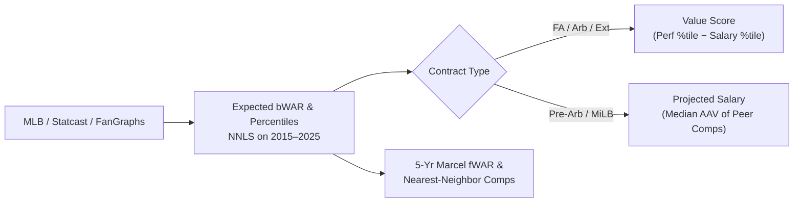

# MLB Market Value — Pay vs. Performance

[](https://www.python.org/)
[](https://fastapi.tiangolo.com/)
[](https://www.postgresql.org/)
[](https://www.sqlite.org/)
[](https://www.docker.com/)
[](LICENSE)

A sabermetric valuation engine and interactive dashboard exploring the relationship between MLB player salaries and on-field performance. It ingests data from the **MLB Stats API**, **Statcast**, and **FanGraphs**, scores players against positional peers, isolates market inefficiencies, and projects open-market contract values.

**Contents:** [Core Logic](#core-logic--methodology) · [Dashboard](#interactive-dashboard) · [Architecture](#architecture--layout) · [Setup](#setup--installation) · [Pipeline](#data-pipeline) · [API](#api-reference) · [Automation](#automated-nightly-refresh) · [Data Sources](#data-sources--coverage)

---

## Overview

Evaluating MLB payroll efficiency is distorted by CBA-controlled pre-arbitration salaries (fixed near the league minimum), surface-stat luck, and differing views on which metrics matter most. **MLB Market Value** solves this by standardizing repeatable process stats by position and season, comparing performance percentiles against market pay percentiles, projecting fair-market salaries for pre-arb players via veteran comps, and letting users re-weight every metric live in the browser.

---

## Core Logic & Methodology



- **Performance Score & Expected bWAR (`expected_war.py`):**
  - **Hitters (~14 stats):** xwOBA, xSLG, xBA, Barrel%, Hard-Hit%, K%, BB%, Chase%, Whiff%, Sprint Speed, SB, OAA, FRV, DRS (plus fWAR, bWAR, wRC+).
  - **Pitchers (~13 stats):** xERA, xBA Allowed, Avg Exit Velo Allowed, Hard-Hit% Allowed, Barrel% Allowed, K%, BB%, Chase% Induced, Whiff% Induced, Z-Swing% Induced, Pitch Release Extension, Stuff+, Location+ (plus FIP, fWAR, bWAR).
  - **Model:** Volume-weighted Non-Negative Least Squares (NNLS) fit on completed seasons (2015–2025, excluding 2020), standardized within season/position ($z$-scores). Each weight represents *bWAR per full season (600 PA / 100 IP) per 1-SD improvement*, exported with 5-fold cross-validated $R^2$.
- **Value Score & Surplus (`compute_value.py`):**
  - For market-priced players (Free Agents, Arbitration, Extensions): $\text{Value Score} = \text{Performance Percentile} - \text{Salary Percentile}$ (positive = underpaid surplus; negative = overpaid).
  - $\text{Surplus} = \text{Projected Market Salary} - \text{Actual Salary}$, graded into **Tier A–F** (with guardrails ensuring net-positive surplus players never land in Tier F).
- **Pre-Arbitration & MiLB Players:** Excluded from direct salary-percentile comparisons because CBA rules cap their pay near the league minimum. They receive a **Projected Market Salary** equal to the median AAV of comparable-performing market-priced peers at the same position.
- **Multi-Year Projections:**
  - **Marcel 5-Year fWAR (`war_projection.py`):** Standardizes the past 3 seasons (per 600 PA / 180 IP SP / 65 IP RP), applies 5-4-3 playing-time weights, regresses toward league average, applies backtested calibration ($\text{Hitters: } 0.71x+0.41$, $\text{SP: } 0.77x+0.45$, $\text{RP: } 0.64x+0.04$), and prices future seasons via aging curves and inflation-adjusted $\$/\text{WAR}$.
  - **Nearest-Neighbor Comps (`comp_projections.py`):** PECOTA-style search matching historical players (2015+) on position-relative $z$-scores across a 2-year trajectory (2× most recent, 1× prior).
- **Live Weight Tuning (`scoring.js`):** Sliders in the **Weights** tab recalculate all player scores, rankings, and team metrics in real time client-side, persisted in `localStorage`.
- **Two-Way Players:** Evaluated separately in batting and pitching pools while deduplicating salaries in team payroll aggregations.

---

## Interactive Dashboard

Hash-routed single-page app served at `/`:

| Route | View |
|---|---|
| `#/home` | League overview, value leaders, overpaid contracts, hot/cold streaks, and team efficiency. |
| `#/players` | Positional boards for Infielders, Outfielders, Rotation, and Bullpen. |
| `#/pre-arbitration` | Cost-controlled players ranked by projected market salary and surplus value. |
| `#/free-agents` | Offseason class with 5-year fWAR projections and open-market contract estimates. |
| `#/teams`, `#/team/<abbr>` | Team payroll efficiency, net roster value, unit breakdowns, and multi-year contract runway. |
| `#/weights` | Live stat and pay weight sliders with instant browser recalculation. |

Clicking any player opens a detailed modal with contract history, Statcast breakdowns, peer comps, fWAR trends, and awards.

---

## Architecture & Layout

- **Backend:** Python 3.11+, FastAPI, SQLAlchemy 2.0, Alembic, pandas, NumPy, SciPy, pybaseball.
- **Zero-Bundler Live Assembly:** FastAPI's `/` route concatenates `frontend/dashboard/parts/` (`head.html`, `topbar.html`, `views.html`, `styles.css`, and 11 ordered `js/*.js` modules) and inlines the DB snapshot (`__DATA_JSON__`) and SVG/font assets at request time. No Node.js or build step—template edits apply on page reload.
- **Two-Tier Caching:** In-memory HTML cache + disk snapshot (`frontend/dashboard/.snapshot_cache/dashboard_{season}.json`) using stale-while-revalidate (30-min TTL, configurable via `DASHBOARD_CACHE_TTL_MINUTES`). Append `?refresh=1` to force a synchronous rebuild.
- **Dual Database:** Defaults to zero-config SQLite (`backend/mlb_market_value.db`) for local dev; uses PostgreSQL 16 in Docker/production.

```
mlb-market-value/
├── backend/
│   ├── alembic/              # Schema migrations
│   ├── app/
│   │   ├── main.py           # FastAPI routes & live template assembler
│   │   ├── dashboard_data.py # Snapshot queries & payload builder
│   │   ├── models.py         # SQLAlchemy ORM models
│   │   └── pipeline/         # ingest, compute_value, expected_war, projections, comp_projections, run_all
│   ├── scripts/              # Backtest & validation utilities
│   └── tests/                # Pytest suite
├── frontend/dashboard/
│   ├── build_dashboard.py    # Snapshot builder for FastAPI
│   ├── assets/               # SVG logos, textures, fonts
│   └── parts/                # head/topbar/views.html, styles.css, js/*.js
├── scripts/                  # dev.sh, prod.sh, nightly_refresh.{sh,ps1}
├── docker-compose.yml        # PostgreSQL 16 + FastAPI stack
└── Dockerfile
```

---

## Setup & Installation

### Option A: Quick Start with SQLite (Fastest)

```bash
git clone https://github.com/dkubek11/mlb-market-value.git
cd mlb-market-value
python -m venv backend/.venv
backend/.venv/bin/pip install -r backend/requirements.txt
scripts/dev.sh
```
*(Windows: `backend\.venv\Scripts\pip install -r backend\requirements.txt`)*

`scripts/dev.sh` runs Alembic migrations and starts Uvicorn on `:8000` ([Dashboard](http://localhost:8000/) · [API Docs](http://localhost:8000/docs)). Run the [ingest pipeline](#data-pipeline) to populate a fresh DB.

### Option B: Docker Compose with PostgreSQL (Recommended)

```bash
export POSTGRES_PASSWORD='choose-a-local-password'   # PowerShell: $env:POSTGRES_PASSWORD="..."
docker compose up -d --build
```

Automatically runs migrations, ingests the current season, computes values, and boots FastAPI on `:8000` (Postgres exposed on host port `5433`). `frontend/dashboard/` is bind-mounted for live edits without rebuilding.

### Option C: Local PostgreSQL (No Docker)

1. Create database `mlb_market_value` and copy `backend/.env.example` to `backend/.env` with your `DATABASE_URL`.
2. Migrate, ingest, and start:
   ```bash
   cd backend && source .venv/bin/activate
   alembic upgrade head
   python -m app.pipeline.run_ingest --season 2026
   python -m app.pipeline.run_compute_value --season 2026
   uvicorn app.main:app --reload --host 0.0.0.0 --port 8000
   ```

---

## Data Pipeline

```bash
cd backend
# Current season (full stats + salaries)
python -m app.pipeline.run_ingest --season 2026
python -m app.pipeline.run_compute_value --season 2026

# Historical backfill (2015–2025; omit salaries, ~4 GB RAM recommended for pitch-level Statcast)
python -m app.pipeline.run_ingest --season 2025 --skip-salary
python -m app.pipeline.run_compute_value --season 2025

# Container/automated runner (migrations + conditional ingest + compute)
python -m app.pipeline.run_all --season 2026 --history-seasons 0
```

---

## API Reference

Interactive docs available at `/docs` (Swagger) and `/redoc`.

| Method | Endpoint | Key Params | Description |
|---|---|---|---|
| `GET` | `/` | `season`, `refresh` | Live-assembled dashboard HTML with inlined snapshot. |
| `GET` | `/health` | — | Health check (`{"status": "ok"}`). |
| `GET` | `/api/dashboard` | `season`, `fetch_live_contracts` | Full dashboard JSON payload (players, teams, contracts, models). |
| `GET` | `/players/value` | `season`, `position`, `sort`, `order`, `limit` | Market-priced players ranked by `value_score`, `composite_percentile`, or `salary_percentile`. |
| `GET` | `/players/projected` | `season`, `position`, `sort`, `order`, `limit` | Pre-arb players ranked by `surplus`, `projected_salary`, or `composite_percentile`. |
| `GET` | `/teams/payroll` | `season`, `sort`, `order` | Team payroll totals and average value scores. |

---

## Automated Nightly Refresh

Refreshes data daily; the dashboard picks up updates when the 30-minute snapshot cache expires (or immediately via `?refresh=1`).

- **Linux / macOS (`cron`):**
  ```bash
  0 3 * * * /path/to/mlb-market-value/scripts/nightly_refresh.sh >> /path/to/mlb-market-value/scripts/logs/cron.log 2>&1
  ```
- **Windows (Task Scheduler):** Run in elevated PowerShell (logs to `scripts/logs/`; see [README.local.md](README.local.md) for details):
  ```powershell
  $Action = New-ScheduledTaskAction -Execute "powershell.exe" -Argument "-NoProfile -ExecutionPolicy Bypass -File C:\path\to\mlb-market-value\scripts\nightly_refresh.ps1"
  $Trigger = New-ScheduledTaskTrigger -Daily -At 3:00AM
  Register-ScheduledTask -TaskName "MLBMarketValueNightlyRefresh" -Action $Action -Trigger $Trigger
  ```

---

## Data Sources & Coverage

| Source | Data |
|---|---|
| **MLB Stats API** | Traditional batting/pitching stats, bios, rosters, awards (MVP, Cy Young, ROY, All-Star, Gold Glove, Silver Slugger). |
| **Statcast (`pybaseball`)** | xwOBA, xBA, xSLG, xERA, exit velocity, barrel%, hard-hit%, sprint speed, OAA, FRV. |
| **Statcast (Pitch-Level)** | Full-season pitch-by-pitch tracking for pitcher release extension. |
| **FanGraphs** | Plate discipline (chase%, whiff%, Z-Swing%), Stuff+, Location+, DRS, fWAR, wRC+. |
| **RosterResource** | Active payrolls, contract status, salaries, and AAVs. |
| **MLB Trade Rumors** | Official arbitration service time (`years.days`) and historical arb settlements. |
| **MLB CDN** | Player headshots and team logos. |

- **2026:** Full stats, advanced metrics, and salaries.
- **2015–2025:** Backfilled performance data only (RosterResource exposes current rosters only).

---

## Testing

```bash
backend/.venv/bin/pytest backend/tests/
```

---

## Collaboration Credits

- **Dylan Kubek** ([@dkubek11](https://github.com/dkubek11))
- **Nathaniel Martinez** ([@natemartinez](https://github.com/natemartinez))

Licensed under the [MIT License](LICENSE).
